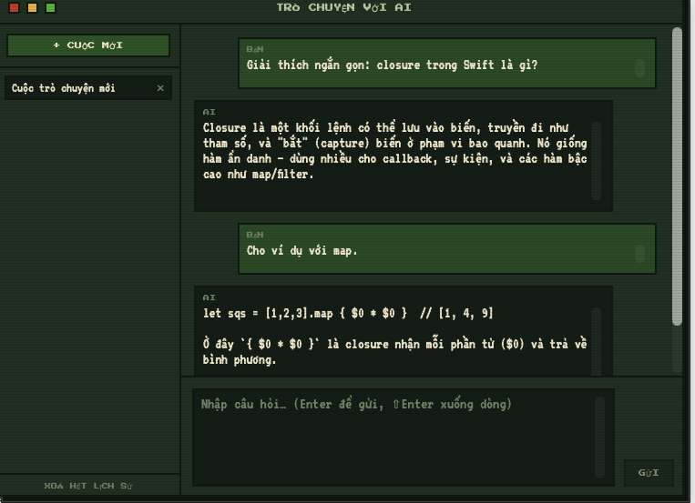
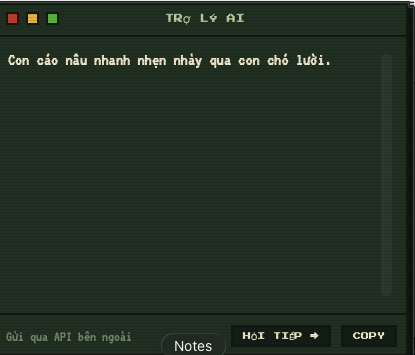

# macos_ime — Bộ gõ Bow Go cho macOS (Swift)

Bộ gõ macOS dùng **CGEvent tap** để chặn phím toàn hệ thống, đưa qua engine tiếng Việt,
rồi "gõ thay" kết quả vào ứng dụng đang focus. Viết bằng **Swift + AppKit**, chạy dạng
app menu-bar (accessory, ẩn Dock). Ngoài gõ tiếng Việt, app còn nhiều tiện ích năng
suất: Trợ lý AI, trò chuyện AI, lịch sử clipboard, gõ tắt/macro, chụp màn hình + OCR…

```
apps/macos_ime/
├── Package.swift            # build & test bằng terminal (Swift Package Manager)
├── Sources/
│   └── VietEngine/          # ENGINE Swift thuần — logic gõ + tiện ích, KHÔNG đụng macOS
│       ├── VietModel.swift  # mô hình: Tone (thanh), Mark (mũ/móc/trăng), InputMethod
│       ├── VietTable.swift  # bảng tra (chữ gốc + mark + tone) -> ký tự Unicode
│       ├── Engine.swift     # bộ não: bọc core Rust (gõ âm tiết) + macro/auto-correct
│   └── CVietCore/           # module C trỏ tới header core Rust packages/viet_core
│       └── AIProvider.swift # logic THUẦN của Trợ lý AI + chat (dựng request/parse)
├── App/                     # APP macOS — CGEvent tap + menu bar + UI pixel-art
│   ├── main.swift               # điểm vào (app accessory, ẩn Dock)
│   ├── AppDelegate.swift        # vòng đời + menu bar + health check + wiring tính năng
│   ├── EventTapController.swift # CGEvent tap: bắt phím/phím tắt -> engine -> gõ thay
│   ├── KeyOutput.swift          # gõ thay ký tự (backspace + post Unicode)
│   ├── KeyboardLayout.swift     # keyCode -> ký tự theo layout THẬT (UCKeyTranslate)
│   ├── KeyCodeMap.swift         # bảng tĩnh QWERTY (fallback) + keyCode phím đặc biệt
│   ├── SettingsStore.swift      # đọc/watch settings.json do app UI Flutter ghi
│   ├── SmartSwitch.swift        # tự nhớ bật/tắt theo từng app (NSWorkspace focus)
│   ├── Permissions.swift        # xin/kiểm tra quyền Accessibility + Input Monitoring
│   ├── StatsTracker.swift       # thống kê gõ (Việt/Anh) -> stats.json
│   ├── SelectionCounter.swift   # đếm từ & ký tự vùng bôi đen
│   ├── TextTransformService.swift # biến đổi text bôi đen (HOA/thường/tính biểu thức…)
│   ├── PixelAlertWindow.swift   # hộp thoại pixel-art dùng chung
│   │   # — Trợ lý AI & Trò chuyện AI —
│   ├── AIProvider.swift → (ở VietEngine)  # logic thuần
│   ├── AIKeychain.swift         # lưu API key trong Keychain bộ gõ (KHÔNG vào settings.json)
│   ├── AIAssistantService.swift # 4 thao tác 1-phát trên vùng bôi đen (đọc AX/clipboard)
│   ├── AIResultWindow.swift     # popup kết quả pixel-art (Copy + "Hỏi tiếp →")
│   ├── AIKeyPromptWindow.swift  # hộp thoại nhập API key / hỏi tự do (pixel-art)
│   ├── AIChatWindow.swift       # cửa sổ TRÒ CHUYỆN nhiều lượt + sidebar lịch sử (pixel-art)
│   ├── AIChatService.swift      # gửi cuộc chat qua URLSession, ghép câu trả lời
│   ├── ChatHistoryStore.swift   # lưu nhiều cuộc chat -> ai_chats.json
│   │   # — Clipboard / picker / ảnh —
│   ├── ClipboardManager.swift   # theo dõi & lưu lịch sử clipboard (text + ảnh)
│   ├── ClipboardHistoryWindow.swift # UI lịch sử clipboard (định nghĩa hệ design Pixel)
│   ├── SymbolPickerWindow.swift # bảng ký tự/emoji (⌃⇧K)
│   ├── StickerPickerWindow.swift + StickerStore.swift # bảng sticker ảnh (⌃⇧J)
│   ├── RecentPickerStore.swift  # "gần đây" (MRU) cho các bảng chọn
│   ├── ScreenshotController.swift + ScreenshotOverlayView.swift # chụp màn hình + chú thích
│   ├── LiveTextWindow.swift     # OCR (Vision) trên ảnh đã chụp/copy
│   └── LoginItem.swift          # bật/tắt khởi động cùng macOS
├── Tests/VietEngineTests/   # test engine + tiện ích (gõ "tieengs" -> "tiếng"?, AI, macro…)
├── Assets/                  # NGUỒN ICON (vector) — sửa ở đây rồi render lại
│   ├── app-icon.svg         # logo app (cung + chìa khoá) -> AppIcon.icns
│   └── menubar-icon.svg     # icon menu bar (template đen/trong suốt)
└── scripts/
    ├── build-app.sh         # đóng gói .app + code sign
    ├── build-dmg.sh         # đóng gói .dmg để phân phối
    └── build-icons.sh       # SVG -> PNG -> AppIcon.icns + menubar.png
```

> **`VietEngine` ở đây bọc core Rust [`packages/viet_core`](../../packages/viet_core)**
> (module C `Sources/CVietCore`, link tĩnh `libviet_core.a`). Core, engine Dart và lớp
> bọc này cùng chạy bộ ca chuẩn [`typing_cases.tsv`](../../packages/viet_engine/spec/typing_cases.tsv).

## Chạy thử engine (không cần quyền gì)

Cần Rust (`brew install rustup && rustup default stable`). Build core trước (đổi core thì
chạy lại — SwiftPM không tự link lại khi chỉ `libviet_core.a` đổi), rồi test:

```bash
cd apps/macos_ime
bash scripts/build-core.sh
swift test          # KHÔNG cần Xcode, KHÔNG cần quyền macOS
```

## Chạy app thật trên máy

```bash
cd apps/macos_ime
bash scripts/build-app.sh        # build + ký -> "build/Bow Go.app"
open "build/Bow Go.app"
```

> **Muốn xem UI pixel-art (font pixel) đúng?** Font `VT323`/`Press Start 2P` chỉ nạp
> khi chạy **bản .app** (đọc từ bundle). Chạy binary trần `.build/debug/BowGo` sẽ
> KHÔNG có font pixel — luôn `build-app.sh` rồi `open` để nhìn giao diện thật.

Lần đầu chạy, app sẽ xin **2 quyền** (bắt buộc của mọi bộ gõ macOS):

1. **Accessibility** (Trợ năng) — để gõ thay ký tự vào app khác.
2. **Input Monitoring** (Giám sát đầu vào) — để đọc phím bạn gõ.

→ Mở **System Settings → Privacy & Security**, tìm mục **Bow Go** ở cả hai phần trên,
bật lên, rồi **mở lại app**. Khi icon menu bar hiện **VN** là đã gõ được.
Bấm icon để bật/tắt, đổi Telex/VNI, mở các tính năng, hoặc thoát.

> **Build lại mà gõ không được (icon hiện EN)?** Chữ ký ad-hoc đổi cdhash mỗi lần
> build → macOS có thể thu hồi quyền dù công tắc vẫn xanh. Khắc phục: vào System
> Settings → Privacy & Security, **xoá hẳn** entry Bow Go (dấu –) ở *cả* Accessibility
> *và* Input Monitoring, thoát app, mở lại để cấp quyền mới. (Bản build hiện đã bỏ
> `--options runtime` để giảm tình trạng này; Developer ID + notarize sẽ dứt điểm.)

## Tiện ích ngoài gõ tiếng Việt

Cấu hình bật/tắt & đổi phím tắt trong app Cài đặt (Flutter). Phím tắt **mặc định**:

| Tính năng | Phím tắt | Ghi chú |
|---|---|---|
| Bật/tắt bộ gõ | ⌃⌥ Space | Đổi Telex/VNI trong menu bar |
| **Trợ lý AI** (chữ bôi đen) | ⌃⇧G | Dịch / tóm tắt / sửa ngữ pháp / hỏi tự do — popup kết quả (Copy, "Hỏi tiếp →") |
| **Trò chuyện với AI** | (menu ⌃⇧G) | Chat nhiều lượt, **lưu lịch sử nhiều cuộc**, sidebar mở lại/xoá cuộc |
| Lịch sử clipboard | ⌃V | Text + ảnh; dán lại nhanh |
| Chụp màn hình + OCR | ⌃⇧S | Chọn vùng, chú thích, nhận chữ (Vision) |
| Biến đổi text bôi đen | ⌃⇧T | HOA/thường, tính biểu thức… |
| Bảng ký tự / emoji | ⌃⇧K | Có mục "gần đây" |
| Bảng sticker ảnh | ⌃⇧J | |
| Đếm từ & ký tự bôi đen | ⌃⇧C | |
| Gõ tắt / macro | (nền) | vd `vn` → `Việt Nam`; cấu hình trong Cài đặt |
| Gõ tắt emoji | (nền) | vd `:cry:` → 😢 (mặc định TẮT) |

**Trợ lý AI** hỗ trợ **Claude** (`claude-opus-4-8`, adaptive thinking) và **OpenAI**
(`gpt-4o`). API key nhập ở **menu bar bộ gõ** và lưu trong **Keychain của bộ gõ**
(không ghi vào `settings.json`, không chia sẻ cross-app do ký ad-hoc). Văn bản/nội
dung chat **được gửi ra API bên ngoài** và (với chat) lưu tại máy ở
`~/Library/Application Support/BowGo/ai_chats.json` — có nút xoá từng cuộc / xoá hết.

### Giao diện (pixel-art)

| Trò chuyện với AI (nhiều lượt + lịch sử) | Kết quả thao tác 1-phát |
|---|---|
|  |  |

*Bên trái: cửa sổ chat với sidebar lịch sử các cuộc. Bên phải: popup kết quả có nút
Copy và "Hỏi tiếp →" (chuyển thành cuộc trò chuyện). Toàn bộ dùng hệ design pixel-art
dùng chung (font VT323/Press Start 2P, viền vuông, panel parchment).*

> Cấu hình bật/tắt & đổi phím tắt ở **app Cài đặt (Flutter)** — xem giao diện trang
> chính trong [`apps/settings_ui/README.md`](../settings_ui/README.md).

## Lộ trình macOS

- [x] App menu-bar (NSStatusItem), accessory (ẩn Dock)
- [x] CGEvent tap: bắt phím, gọi engine, "gõ thay" ký tự
- [x] Xin & kiểm tra quyền Accessibility + Input Monitoring
- [x] Cơ chế phục hồi tap khi macOS tự tắt (health check 5s)
- [x] Đóng gói .app + code sign (ad-hoc) + .dmg
- [x] Bật/tắt + đổi Telex/VNI qua menu; phím tắt bật/tắt ⌃⌥ Space
- [x] Đọc cấu hình từ app UI Flutter qua file JSON dùng chung; phím tắt tuỳ biến
- [x] Dịch keyCode theo layout thật (UCKeyTranslate) — đúng cả Dvorak/Colemak/AZERTY
- [x] Smart Switch: tự nhớ bật/tắt theo từng app
- [x] Gõ tắt/macro, gõ tắt emoji, hoàn tác khi bung
- [x] Lịch sử clipboard (text + ảnh)
- [x] Bảng ký tự/emoji + bảng sticker ảnh (có "gần đây")
- [x] Đếm từ & ký tự, biến đổi text bôi đen, thống kê gõ
- [x] Chụp màn hình + chú thích + OCR (Vision)
- [x] Trợ lý AI (Claude/OpenAI) trên vùng bôi đen — 4 thao tác
- [x] Trò chuyện AI nhiều lượt + lưu lịch sử nhiều cuộc
- [ ] Developer ID + notarize để phân phối
