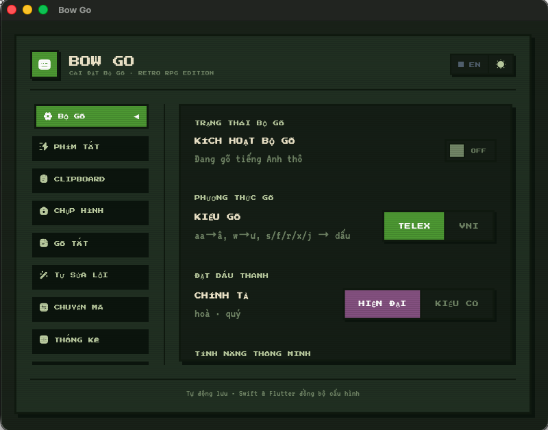

# bow_settings — App cài đặt Bow Go (Flutter)

Giao diện cấu hình bộ gõ Bow Go (phong cách pixel). App ghi cấu hình ra một file
JSON **dùng chung** với bộ gõ nền tảng; bộ gõ đọc & nạp lại khi file đổi.



*Trang chính (tab "Bộ gõ"): sidebar chuyển tab, bật/tắt bộ gõ, chọn kiểu gõ
Telex/VNI, kiểu bỏ dấu… Toàn bộ theo phong cách pixel "Retro RPG Edition".*

## "Đường dây" cấu hình

| Nền tảng | File dùng chung | Bên đọc |
|---|---|---|
| macOS | `~/Library/Application Support/BowGo/settings.json` | bộ gõ Swift (`apps/macos_ime`) |
| Windows | `%APPDATA%\BowGo\settings.json` | text service TSF (`apps/windows_ime`) |

Đường dẫn tập trung ở [lib/src/services/bow_paths.dart](lib/src/services/bow_paths.dart)
— **không** hard-code chỗ khác, kẻo đứt đường dây với bộ gõ.

## Chạy trên macOS

```bash
cd apps/settings_ui
flutter run -d macos
```

## Chạy trên Windows

Nền tảng Windows **đã sẵn sàng ở tầng code** (đường dẫn `%APPDATA%\BowGo`, các
luồng đặc thù macOS như sửa quyền TCC đã được `Platform.isMacOS`-guard). Chỉ cần
sinh thư mục runner `windows/` một lần (Flutter tự tạo, chỉ chạy được trên máy
Windows có Visual Studio + Windows SDK):

```powershell
cd apps\settings_ui
flutter create --platforms=windows .    # sinh windows\ runner (chạy 1 lần)
flutter run -d windows
```

Onboarding quyền **không hiện trên Windows** (TSF không cần quyền TCC như macOS):
`status.json` không tồn tại → trạng thái `known=false` → app vào thẳng màn cài đặt.

### App đồng hành trên Windows (clipboard + chụp màn hình)

Trên macOS, lịch sử clipboard và chụp màn hình do bộ gõ Swift lo. Trên Windows,
app Flutter này kiêm luôn — chạy nền dưới **khay hệ thống** ([WindowsRuntime]):

- **Icon khay** + menu chuột phải (Mở cài đặt / Lịch sử clipboard / Chụp màn hình / Thoát).
- **Đóng cửa sổ = ẩn xuống khay** (app vẫn chạy để giữ phím tắt + theo dõi clipboard).
- **Phím tắt toàn cục** (đọc từ `settings.json`, `hotkey_manager`):
  mở lịch sử clipboard, chụp màn hình. Lưu ý: phím tắt phải có phím THẬT +
  modifier (tổ hợp chỉ-modifier ⌃⇧ không dùng được cho hotkey toàn cục).
- **Lịch sử clipboard** ([ClipboardHistoryService]): poll clipboard mỗi 800ms,
  lưu text + ảnh, bền hoá vào `%APPDATA%\BowGo\clipboard_history.json`. Overlay
  pixel ([ClipboardHistoryOverlay]) hiện danh sách, bấm để dán lại.
- **Chụp màn hình** ([ScreenshotService]): chọn vùng, lưu PNG + copy clipboard.
  (Chú thích/OCR như bản macOS để lộ trình sau.)

Các plugin dùng: `window_manager`, `tray_manager`, `hotkey_manager`,
`super_clipboard`, `screen_capturer` (đều hỗ trợ Windows; xem `pubspec.yaml`).
Toàn bộ được `Platform.isWindows`-guard nên KHÔNG ảnh hưởng bản macOS.

> Icon khay: đặt file `assets/tray/bowgo.ico` (thiếu vẫn chạy, chỉ không có icon).

## Tab hiện có (theo `SettingsTab`)

`general` · `shortcuts` · `clipboard` · `screenshot` · `macros` · `autocorrect` ·
`convert` · `troubleshoot` · `update` · `about`.

> Ghi chú Windows: tab **SỬA LỖI** (troubleshoot) và onboarding là luồng quyền
> macOS; trên Windows các nút này báo "chỉ có trên macOS". Tab **CLIPBOARD** /
> **CHỤP HÌNH** cấu hình tính năng của app đồng hành — trên Windows cần app khay
> hệ thống riêng để hiện thực (xem lộ trình trong `apps/windows_ime/README.md`).
